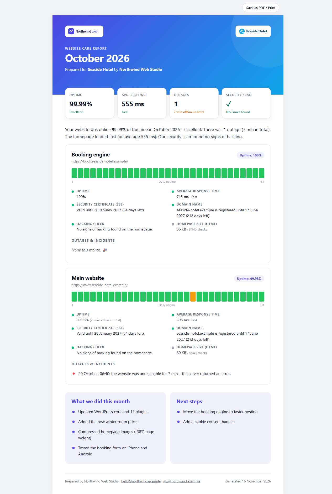
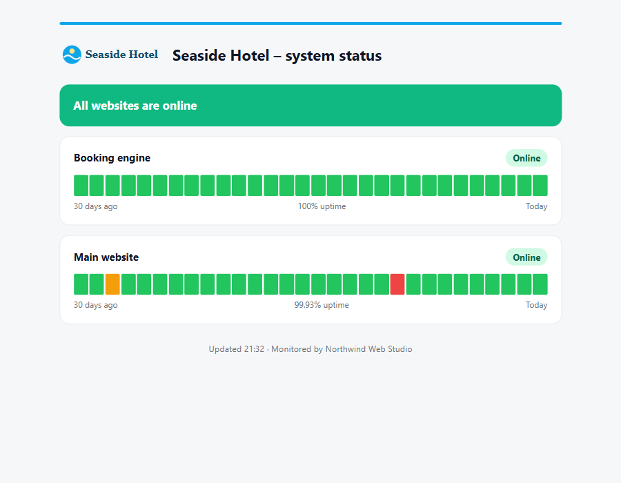

# client-uptime

**Monitor your clients' websites and send them a beautiful monthly report — under your own brand.**

Self-hosted, open source, zero dependencies. Built for freelancers and small web agencies who want to show clients what their monthly maintenance fee pays for.



| Agency dashboard | Client status page |
| --- | --- |
|  |  |

> Screenshots use the built-in demo data (`--demo`): a fictional agency with fictional clients. The same report in Bulgarian: [report-bg.png](docs/screenshots/report-bg.png).

## Why another uptime monitor?

Tools like Uptime Kuma, Gatus or Upptime are great at *watching* websites. But if you build sites for clients, the hard part is not knowing that a site was down — it is **explaining to the client, every month, why paying you is worth it**.

client-uptime is built around that monthly report:

- **White-label report** with your logo and colours *and* the client's logo — uptime %, average speed, outages explained in plain words ("On 3 October at 14:05 the website was unreachable for 23 minutes – the server did not answer in time"), SSL and domain expiry, a hacking check, **what you did this month** and **next steps**.
- **Work log**: jot down what you did for a client during the month; it lands in the next report automatically.
- **Sent on the 1st** (or as drafts for you to review first), or with one click. Each report has a private link with a long random token.
- **Multilingual**: English and Bulgarian included; reports use each client's language. Adding a language = copying one JSON file.

## Features

- **Checks** every N minutes per site: HTTP status, response time, homepage size, optional "must contain" keyword.
- **No false alarms**: a failed check is retried (configurable) before anything is reported.
- **SSL certificate**: days until expiry, invalid/expired certificates.
- **Domain expiry via RDAP** (the free, official successor of WHOIS) — no paid APIs. Some registries (for example many country-code TLDs) do not offer RDAP or do not publish the expiry date; the report says so honestly instead of guessing.
- **Hacked-site signals**: spam words injected into the homepage (casino, viagra, kmspico, …, configurable, with a per-site ignore list) and sudden homepage title changes.
- **Alerts for you**: Telegram, e-mail (SMTP), [ntfy](https://ntfy.sh), generic webhook (JSON).
- **Public status page** per client (optional).
- **Agency panel** with password login, sessions, CSRF protection; English or Bulgarian UI.
- Runs on Windows, macOS, Linux, a Raspberry Pi or a $5 VPS. Data lives in one SQLite file.

## Quick start

Requires **Node.js 22.13+** (it uses the built-in `node:sqlite`, so there is nothing else to install).

```bash
npx client-uptime
```

Open http://localhost:3000, enter the **setup code** printed in the terminal, choose a password — done.

Want to look around first? Start the demo (fictional data, no real checks, nothing is sent):

```bash
npx client-uptime --demo        # password: demo-password
```

> The npm package is not published yet. Until then: `git clone` this repository, then `node bin/client-uptime.js` (or `--demo`).

### Docker

```bash
docker build -t client-uptime .
docker run -d --name client-uptime -p 3000:3000 -v client-uptime-data:/data client-uptime
docker logs client-uptime     # shows the setup code on first start
```

### Options

| Flag | Env | Default | |
| --- | --- | --- | --- |
| `--port` | `PORT` | `3000` | |
| `--host` | `HOST` | `127.0.0.1` | use `0.0.0.0` to accept outside connections (the Docker image does) |
| `--data` | `DATA_DIR` | `./client-uptime-data` | database location |
| `--dry-run` | `DRY_RUN=1` | off | never send e-mails or alerts, only log them |
| `--trust-proxy` | `TRUST_PROXY=1` | off | behind nginx/Caddy/Traefik: trust `X-Forwarded-*` |
| `--demo` | | off | fictional demo data |

For the e-mail links to work, set the **Public URL** in Settings (for example `https://monitor.example.com`) and put the app behind HTTPS (Caddy does this with two lines of config).

### PDF

Every report has a print-optimised A4 layout, so **"Save as PDF" in any browser** gives a clean PDF — no extra software needed.
If you want server-side PDFs (download link + PDF attached to the e-mail), install Playwright next to the app — it is optional because it downloads a ~150 MB browser:

```bash
npm install playwright && npx playwright install chromium
```

## How it works

```
 every 15 s ─► scheduler ─► due sites ─► HTTP check (retry before alerting)
                                    ├─► TLS check   (every 6 h)
                                    └─► RDAP lookup (every 24 h)
                                             │
             incidents (open/close) ◄────────┘──► alerts to you (Telegram / e-mail / ntfy / webhook)
                      │
 1st of the month ─► report snapshot per client ─► private link /r/<token> ─► e-mail to client
```

- **Uptime %** = time without a confirmed outage ÷ monitored time in the month (monitoring starts at a site's first check, so a site added mid-month is not penalised). Months follow your time zone.
- **Incident** = a confirmed failure (after retries). It starts at the first failed attempt and ends at the first successful check.
- A **report** is a frozen snapshot: the numbers don't change after you send it. "Refresh numbers" rebuilds it; your notes are kept.
- Everything is stored in `client-uptime-data/client-uptime.db` (SQLite). Back up that one file.

## Security

- First-run setup requires a one-time **setup code** printed to the console, so nobody can claim a fresh instance before you.
- Passwords are hashed with **scrypt**; sessions are random 256-bit tokens stored **hashed** in the database; cookies are `HttpOnly` + `SameSite` (+ `Secure` over HTTPS).
- **CSRF tokens** on every form plus an Origin check on every POST; login is rate-limited.
- Strict **Content-Security-Policy**, `X-Frame-Options: DENY`, `Referrer-Policy: no-referrer`; all output is HTML-escaped.
- Report and status links use long random tokens, are marked `noindex`, and a report link can be rotated at any time.
- Secrets (SMTP password, bot tokens) live only in your local database — never in the code or the repository — and are never sent back to the browser.
- The SMTP client refuses to send a password over an unencrypted connection.

Found a vulnerability? Please open a private security advisory on GitHub instead of a public issue.

## Development

```bash
npm test          # node:test, no dependencies; uses local test servers, never the real network for alerts
```

Project layout: `src/checks` (HTTP, TLS, RDAP, content), `src/monitor.js` (scheduling, incidents, alerts), `src/report.js` + `src/web/report-view.js` (reports), `src/web` (panel), `locales/*.json` (texts).

**Add a language:** copy `locales/en.json` to `locales/xx.json`, translate the values, set `_meta.name` and `_meta.locale`. The test suite checks that no key is missing.

## How it compares

| | client-uptime | Uptime Kuma | Gatus | Upptime | Paid SaaS (UptimeRobot, Better Stack, ManageWP reports, …) |
| --- | --- | --- | --- | --- | --- |
| Self-hosted, free | ✅ | ✅ | ✅ | ✅ (GitHub Actions) | ❌ |
| Monthly white-label client report | ✅ | ❌ | ❌ | ❌ | ✅ (paid plans / add-ons) |
| "What we did this month" + work log | ✅ | ❌ | ❌ | ❌ | some (ManageWP: WordPress only) |
| Client language per report (en, bg, add your own) | ✅ | — | — | — | varies |
| Many monitor types (TCP, DNS, Docker, …) | ❌ HTTP(S) only | ✅ | ✅ | ❌ | ✅ |

If you need dozens of monitor types, use Uptime Kuma. If you need to **show clients the value of your work**, use this — or both.

## Limits (honest list)

- Checks are HTTP(S) only (no ping/TCP/DNS monitors yet).
- Response time is measured from wherever you run client-uptime; it is the homepage HTML only (not images/scripts), not a full browser page-speed test.
- The hacking check looks at the homepage HTML for known spam words and title changes. It is an early warning, not a malware scanner.
- Domain expiry depends on the registry offering RDAP with an expiry date.
- One agency account (single password) per installation.

## License

[MIT](LICENSE)
