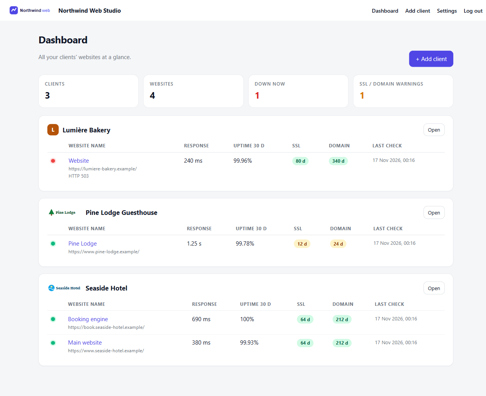
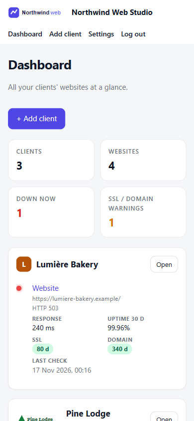

# sitesteward

**Monitor your clients' websites and send them a beautiful monthly report — under your own brand.**

Self-hosted, open source, **zero dependencies** (Node.js built-ins only). Built for freelancers and small web agencies who want to show clients what their monthly maintenance fee pays for.


| Agency dashboard | Client status page | On a phone |
| --- | --- | --- |
|  |  |  |

> Screenshots use the built-in demo data (`--demo`): a fictional agency with fictional clients. The same report in Bulgarian: [report-bg.png](docs/screenshots/report-bg.png), the report on a phone: [report-phone.png](docs/screenshots/report-phone.png).

## Why another uptime monitor?

Tools like Uptime Kuma, Gatus or Upptime are great at *watching* websites. But if you build sites for clients, the hard part is not knowing that a site was down — it is **explaining to the client, every month, why paying you is worth it**.

sitesteward is built around that monthly report:

- **White-label report** with your logo and colours *and* the client's logo — uptime %, average speed, outages explained in plain words ("On 3 October at 14:05 the website was unreachable for 23 minutes – the server did not answer in time"), SSL and domain expiry, a hacking check, **what you did this month** and **next steps**.
- **Work log**: jot down what you did for a client during the month; it lands in the next report automatically.
- **Sent on the 1st** (or created as drafts for you to review first), or with one click. Each report has a private link with a long random token. Print-ready A4 layout, so "Save as PDF" in any browser gives a clean PDF.
- **Multilingual**: English and Bulgarian included; each client gets reports in their own language. Adding a language = copying one JSON file.

## Features

- **Checks** every N minutes per site: HTTP status, response time, homepage size, optional "must contain" keyword.
- **No false alarms**: a failed check is retried (configurable) before anything is reported; a network blip during the SSL check is not reported as an SSL problem.
- **SSL certificate**: days until expiry, expired / untrusted / wrong-host certificates; warnings at 21, 14, 7, 3 and 1 days.
- **Domain expiry via RDAP** (the free, official successor of WHOIS) — no paid APIs; warnings at 30, 14, 7 and 1 days. Some registries (many country-code TLDs) do not offer RDAP or do not publish the expiry date; the report says so honestly instead of guessing.
- **Hacked-site signals**: spam words injected into the homepage (casino, viagra, kmspico, …, configurable, with a per-site ignore list) and sudden homepage title changes.
- **Honest numbers**: uptime counts only the time a site was really monitored. If sitesteward was switched off for a day, that day shows "no data" — never a made-up 100 %.
- **Alerts for you**: Telegram, e-mail (SMTP), [ntfy](https://ntfy.sh), generic webhook (JSON).
- **Public status page** per client (optional).
- **Agency panel** with password login, sessions and CSRF protection; English or Bulgarian UI; works on desktop and phone.
- **Pause** a website without losing its history; **one-click backup** of the whole database.
- Runs on Windows, macOS, Linux, a Raspberry Pi or a $5 VPS. All data lives in one SQLite file.

## Quick start

Requires **Node.js 22.13+** (it uses the built-in `node:sqlite`, so there is nothing else to install).

```bash
git clone https://github.com/me7ko-dev/sitesteward.git
cd sitesteward
node bin/sitesteward.js
```

Open http://localhost:3000, enter the **setup code** printed in the terminal, choose a password — done.

Want to look around first? Start the demo (fictional data, no real checks, nothing is sent):

```bash
node bin/sitesteward.js --demo        # password: demo-password
```

> An npm package (`npx sitesteward`) is planned but not published yet.

### First steps after setup

1. **Settings → Your brand**: agency name, logo, colour, contact e-mail and website (they appear on every report).
2. **Settings → General**: your time zone (months and the 1st-of-the-month schedule follow it) and the **public URL** of the panel (needed for links in e-mails).
3. **Settings → E-mail (SMTP)**: any provider works — for Gmail use `smtp.gmail.com`, port `587`, your address as user and an [app password](https://support.google.com/accounts/answer/185833).
4. **Settings → Alerts for you**: e.g. Telegram (create a bot with [@BotFather](https://t.me/BotFather), then put the bot token and your chat ID) — press "Test" to check it.
5. **Add client** → name, report e-mail, language → **Add website**. The first check runs immediately.
6. During the month, add entries to the client's **Work log**. On the 1st you get a notification that the reports are ready (or they go out automatically, if you chose that in Settings → Monthly reports).

### Options

| Flag | Env | Default | |
| --- | --- | --- | --- |
| `--port` | `PORT` | `3000` | |
| `--host` | `HOST` | `127.0.0.1` | use `0.0.0.0` to accept outside connections (the Docker image does) |
| `--data` | `DATA_DIR` | `./sitesteward-data` | database location (relative to the current directory) |
| `--dry-run` | `DRY_RUN=1` | off | never send e-mails or alerts, only log them |
| `--trust-proxy` | `TRUST_PROXY=1` | off | behind nginx/Caddy/Traefik: trust `X-Forwarded-*` |
| `--demo` | | off | fictional demo data in `./sitesteward-demo` |
| `--version` | | | print the version |

Everything else (brand, SMTP, alerts, intervals, retries, spam words, report schedule) is configured in the panel and stored in the database.

## Running it permanently

sitesteward is a single long-running Node process. Pick one:

### Linux (systemd)

A hardened unit file is included: [`docs/deploy/sitesteward.service`](docs/deploy/sitesteward.service).

```bash
sudo useradd --system --create-home --home-dir /opt/sitesteward sitesteward
sudo -u sitesteward git clone https://github.com/me7ko-dev/sitesteward.git /opt/sitesteward/app
sudo cp /opt/sitesteward/app/docs/deploy/sitesteward.service /etc/systemd/system/
sudo systemctl daemon-reload && sudo systemctl enable --now sitesteward
journalctl -u sitesteward -n 20      # shows the setup code on the first start
```

Data is stored in `/var/lib/sitesteward`. To update: `cd /opt/sitesteward/app && sudo -u sitesteward git pull && sudo systemctl restart sitesteward`.

### Docker

```bash
docker build -t sitesteward .
docker run -d --name sitesteward --restart unless-stopped -p 3000:3000 -v sitesteward-data:/data sitesteward
docker logs sitesteward     # shows the setup code on the first start
```

### Windows

Run `node bin\sitesteward.js --data C:\sitesteward-data` once in a terminal and complete the setup. Then stop it (Ctrl+C) and register it to start with Windows (PowerShell as administrator, adjust the paths):

```powershell
$action   = New-ScheduledTaskAction -Execute "node.exe" -Argument "C:\sitesteward\bin\sitesteward.js --data C:\sitesteward-data" -WorkingDirectory "C:\sitesteward"
$trigger  = New-ScheduledTaskTrigger -AtStartup
$settings = New-ScheduledTaskSettingsSet -RestartCount 999 -RestartInterval (New-TimeSpan -Minutes 1) -ExecutionTimeLimit ([TimeSpan]::Zero)
Register-ScheduledTask -TaskName "sitesteward" -Action $action -Trigger $trigger -Settings $settings -User "SYSTEM"
```

### macOS

Use a LaunchAgent (`~/Library/LaunchAgents/com.sitesteward.plist`) with `ProgramArguments` = `/usr/local/bin/node`, `/path/to/sitesteward/bin/sitesteward.js`, `--data`, `/path/to/sitesteward-data`, plus `RunAtLoad` and `KeepAlive` set to `true`; load it with `launchctl load ~/Library/LaunchAgents/com.sitesteward.plist`.

### HTTPS

For e-mail links and the client status pages, put sitesteward behind HTTPS. With [Caddy](https://caddyserver.com) this is two lines — see [`docs/deploy/Caddyfile`](docs/deploy/Caddyfile). Start sitesteward with `--trust-proxy` and set **Settings → Public URL** to your `https://` address.

### Backups and restarts

- Everything is in one file: `<data dir>/sitesteward.db` (SQLite, WAL mode). **Settings → Backup** downloads a consistent copy at any time, without stopping the app. To restore, stop sitesteward and replace `sitesteward.db` with the backup (delete any `sitesteward.db-wal` / `-shm` files next to it).
- Restarts and crashes are safe: open outages, alert state and settings are in the database; checks continue where they stopped. If sitesteward was not running on the 1st of the month, the monthly reports are created when it starts again (during the first week). Time when nothing was monitored is excluded from uptime.
- Check history older than 400 days is pruned automatically.

### PDF

Every report has a print-optimised A4 layout, so **"Save as PDF" in any browser** gives a clean PDF — no extra software needed.
If you want server-side PDFs (download link + PDF attached to the e-mail), install Playwright next to the app — it is optional because it downloads a ~150 MB browser:

```bash
npm install playwright && npx playwright install chromium
```

## How it works

```
 every 15 s ─► scheduler ─► due sites ─► HTTP check (retry before alerting)
                                    ├─► TLS check   (every 6 h, 30 min after a network error)
                                    └─► RDAP lookup (every 24 h)
                                             │
             incidents (open/close) ◄────────┘──► alerts to you (Telegram / e-mail / ntfy / webhook)
                      │
 1st of the month ─► report snapshot per client ─► private link /r/<token> ─► e-mail to client
```

- **Uptime %** = time without a confirmed outage ÷ *monitored* time in the month. Monitored time is derived from the stored checks: gaps between checks of up to max(3 × the check interval, 2 hours) count as monitored; longer gaps (sitesteward was off, the site was paused or not added yet) are left out completely. Months follow your time zone.
- **Incident** = a confirmed failure (after retries). It starts at the first failed attempt and ends at the first successful check.
- A **report** is a frozen snapshot: the numbers don't change after you send it. "Refresh numbers" rebuilds it; your notes are kept.

## Security

- First-run setup requires a one-time **setup code** printed to the console, so nobody can claim a fresh instance before you. Guessing it is rate-limited.
- Passwords are hashed with **scrypt**; sessions are random 256-bit tokens stored **hashed** in the database; cookies are `HttpOnly` + `SameSite` (+ `Secure` over HTTPS).
- **CSRF tokens** on every form plus an Origin check on every POST; login is rate-limited.
- Strict **Content-Security-Policy**, `X-Frame-Options: DENY`, `Referrer-Policy: no-referrer`; all output is HTML-escaped.
- Report and status links use long random tokens, are marked `noindex`, and a report link can be rotated at any time.
- Secrets (SMTP password, bot tokens) live only in your local database — never in the code or the repository — and are never sent back to the browser. Treat backups as secret, too.
- The SMTP client refuses to send a password over an unencrypted connection.

Found a vulnerability? Please open a private security advisory on GitHub instead of a public issue.

## Development

```bash
npm test          # node:test, no dependencies; uses local test servers, never the real network for alerts
```

The suite covers the checks (HTTP, TLS, RDAP, spam words), the monitor (retries, incidents, alerts, SSL/domain thresholds, pause, races), uptime math, reports (both languages, XSS, schedule and catch-up), SMTP, the web panel (setup, login, CSRF, settings, backup) and an end-to-end run of the real CLI including a crash and restart.

Project layout: `bin/` (CLI), `src/checks` (HTTP, TLS, RDAP, content), `src/monitor.js` (scheduling, incidents, alerts), `src/stats.js` (uptime math), `src/report.js` + `src/web/report-view.js` (reports), `src/web` (panel), `locales/*.json` (texts), `docs/deploy` (service examples).

**Add a language:** copy `locales/en.json` to `locales/xx.json`, translate the values, set `_meta.name` and `_meta.locale`. The test suite checks that no key is missing.

See [CHANGELOG.md](CHANGELOG.md) for what changed between versions.

## How it compares

| | sitesteward | Uptime Kuma | Gatus | Upptime | Paid SaaS (UptimeRobot, Better Stack, ManageWP reports, …) |
| --- | --- | --- | --- | --- | --- |
| Self-hosted, free | ✅ | ✅ | ✅ | ✅ (GitHub Actions) | ❌ |
| Monthly white-label client report | ✅ | ❌ | ❌ | ❌ | ✅ (paid plans / add-ons) |
| "What we did this month" + work log | ✅ | ❌ | ❌ | ❌ | some (ManageWP: WordPress only) |
| Client language per report (en, bg, add your own) | ✅ | — | — | — | varies |
| Many monitor types (TCP, DNS, Docker, …) | ❌ HTTP(S) only | ✅ | ✅ | ❌ | ✅ |

If you need dozens of monitor types, use Uptime Kuma. If you need to **show clients the value of your work**, use this — or both.

## Limits (honest list)

- Checks are HTTP(S) only (no ping/TCP/DNS monitors yet).
- Response time is measured from wherever you run sitesteward; it is the homepage HTML only (not images/scripts), not a full browser page-speed test.
- The hacking check looks at the homepage HTML for known spam words and title changes. It is an early warning, not a malware scanner.
- Domain expiry depends on the registry offering RDAP with an expiry date.
- One agency account (single password) per installation.
- Server-side PDF needs the optional Playwright install; without it, clients use the browser's "Save as PDF".

## License

[MIT](LICENSE)
